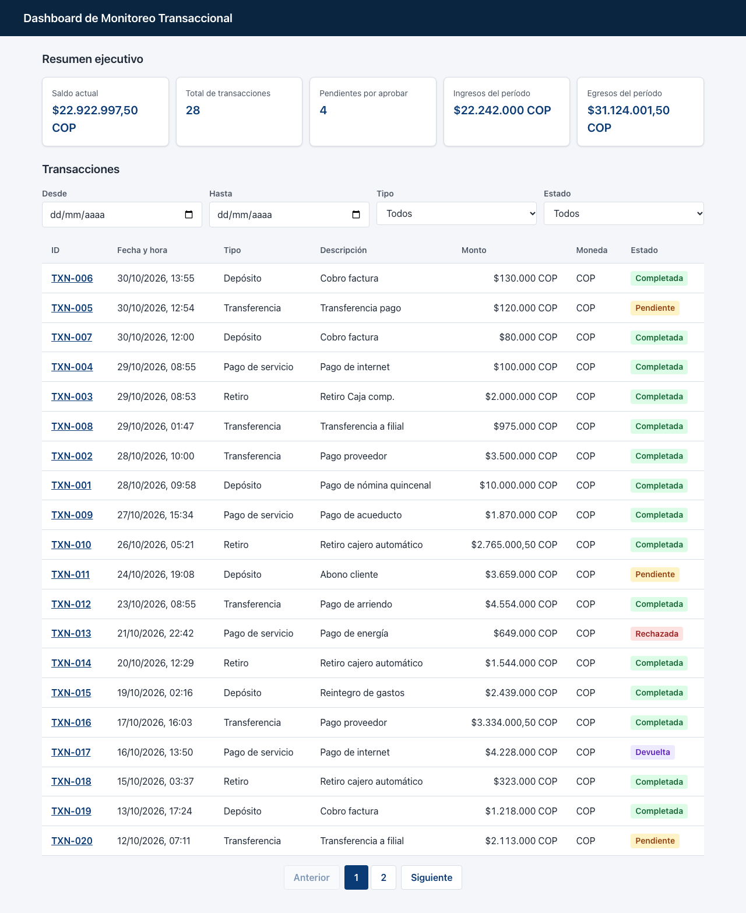
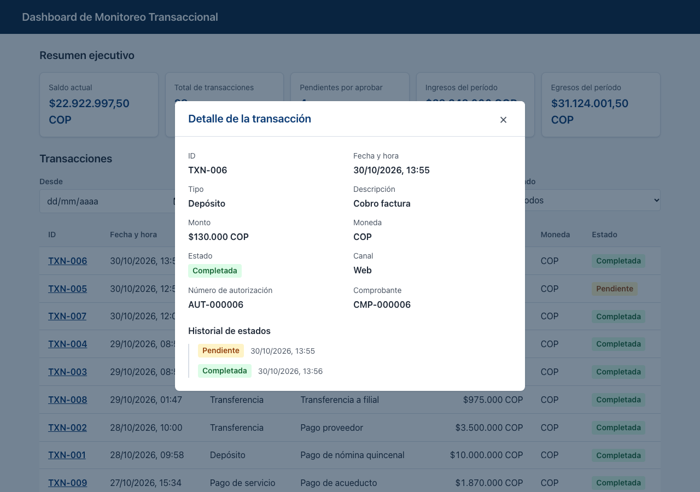
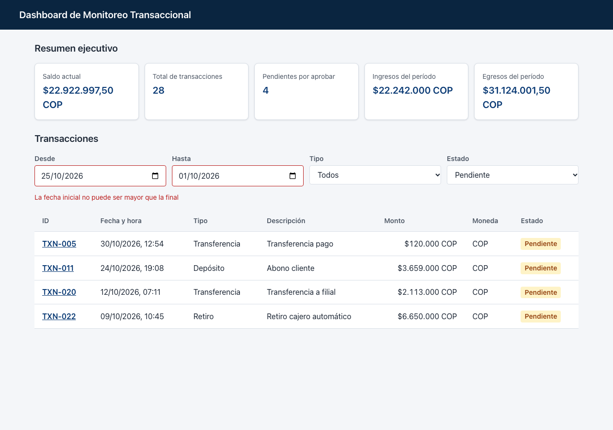
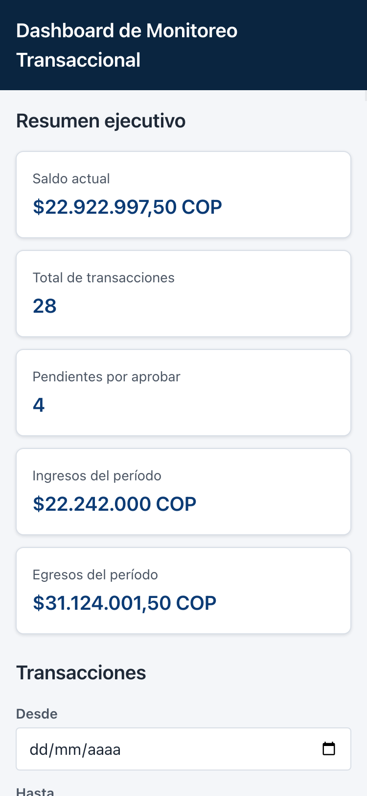
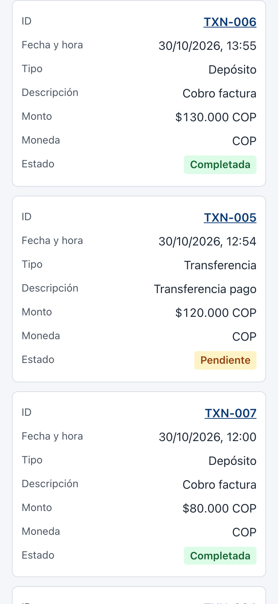
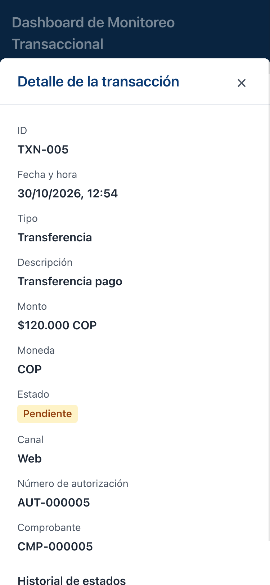

# Dashboard de Monitoreo Transaccional

Aplicación web para que los clientes empresariales de una plataforma de banca en línea **consulten y
analicen sus movimientos financieros**: resumen ejecutivo del período, listado de transacciones con
filtros y paginación, y detalle completo de cada transacción con su historial de estados.

Construida con **React 19 + TypeScript**, estado global con **Context API + Reducers**, consumo
de API REST con **Axios** y una API simulada con **MSW**, por lo que se ejecuta **sin ningún backend ni
dependencia externa**.



---

## Tabla de contenido

1. [Funcionalidades](#1-funcionalidades)
2. [Capturas de pantalla](#2-capturas-de-pantalla)
3. [Requisitos](#3-requisitos)
4. [Ejecución local](#4-ejecución-local)
5. [Scripts disponibles](#5-scripts-disponibles)
6. [Variables de entorno](#6-variables-de-entorno)
7. [Pruebas](#7-pruebas)
8. [Arquitectura](#8-arquitectura)
9. [Estructura de carpetas](#9-estructura-de-carpetas)
10. [Componentes](#10-componentes)
11. [Hooks y manejo del estado](#11-hooks-y-manejo-del-estado)
12. [Navegación y paginación por URL](#12-navegación-y-paginación-por-url)
13. [Capa de API y manejo de errores](#13-capa-de-api-y-manejo-de-errores)
14. [API simulada (MSW)](#14-api-simulada-msw)
15. [Reglas de negocio](#15-reglas-de-negocio)
16. [Estilos, responsive y accesibilidad](#16-estilos-responsive-y-accesibilidad)
17. [Seguridad](#17-seguridad)
18. [Tecnologías utilizadas](#18-tecnologías-utilizadas)
19. [Decisiones de diseño y trade-offs](#19-decisiones-de-diseño-y-trade-offs)
20. [Proceso de desarrollo (SDD)](#20-proceso-de-desarrollo-sdd)
21. [Limitaciones conocidas](#21-limitaciones-conocidas)

---

## 1. Funcionalidades

| Requerimiento | Descripción |
|---|---|
| **RF-01 · Resumen ejecutivo** | Saldo actual, total de transacciones, pendientes por aprobar, ingresos y egresos del período. Período fijo: **mensual** (sin selector) |
| **RF-02 · Listado con filtros** | Tabla con ID, fecha y hora, tipo, descripción, monto, moneda y estado. Filtros combinables (AND) por **rango de fechas**, **tipo** y **estado**. Paginación de **20 registros** por página |
| **RF-03 · Detalle de transacción** | Modal con todos los campos, canal, número de autorización, comprobante e **historial de cambios de estado** |

Además:

- Estados de **carga, error (con Reintentar) y vacío** independientes para resumen, listado y detalle.
- **Paginación en la URL** (`?page=2`): se conserva al recargar y al abrir/cerrar el detalle.
- El detalle tiene **URL propia** (`/transactions/TXN-005`) y se puede abrir directamente.
- **Diseño responsive**: la tabla se convierte en tarjetas en mobile.

Fuera de alcance (según el SPEC): alertas, actualización en tiempo real, reportes y monedas distintas a COP.

---

## 2. Capturas de pantalla

> Capturas tomadas sobre el **build de producción** (`yarn build` + `yarn preview`) con la API simulada.
> La fecha del navegador se fijó en el 30/10/2026 para mostrar un mes con más de una página.

### Escritorio

| Dashboard | Detalle de transacción |
|---|---|
|  |  |

**Filtros combinados con rango de fechas invertido** (se avisa y se aplican solo tipo y estado):



### Mobile (375 px)

| Resumen | Transacciones como tarjetas | Detalle |
|---|---|---|
|  |  |  |

---

## 3. Requisitos

| Herramienta | Versión |
|---|---|
| **Node.js** | `22.22.2` o superior (`24.15+` o `26+` también son compatibles). Probado con Node `26.5.0` |
| **Yarn** | `1.22.x` (classic) |
| Navegador | Cualquier navegador moderno con soporte de Service Workers (Chrome, Edge, Firefox, Safari) |

> La versión mínima de Node la imponen `jsdom` (pruebas) y `react-router` v8.

---

## 4. Ejecución local

```bash
# 1. Clonar el repositorio
git clone <url-del-repositorio>
cd ceiba-front

# 2. Instalar dependencias
yarn install

# 3. Levantar el servidor de desarrollo
yarn dev
```

Abrir **http://localhost:5173**. La API simulada (MSW) se activa automáticamente: en la consola del
navegador aparece `[MSW] Mocking enabled.` y cada petición a `/api/v1/...` se registra con su respuesta.

### Build de producción

```bash
yarn build      # verifica tipos (tsc -b) y genera dist/
yarn preview    # sirve dist/ en http://localhost:4173
```

El build también funciona sin backend: `dist/` incluye `mockServiceWorker.js` y los mocks están activos
por defecto (`VITE_USE_MOCKS=true`, decisión DP-14).

### Rutas de la aplicación

| URL | Vista |
|---|---|
| `/` | Dashboard (resumen + listado) |
| `/?page=2` | Dashboard en la página 2 del listado |
| `/transactions/TXN-005` | Dashboard con el detalle de TXN-005 abierto como modal |
| cualquier otra | Página "Página no encontrada" |

---

## 5. Scripts disponibles

| Script | Comando | Descripción |
|---|---|---|
| `yarn dev` | `vite` | Servidor de desarrollo con recarga en caliente |
| `yarn build` | `tsc -b && vite build` | Verificación de tipos y build de producción en `dist/` |
| `yarn preview` | `vite preview` | Sirve el build de producción |
| `yarn lint` | `eslint .` | Análisis estático (incluye la regla que prohíbe `any`) |
| `yarn test` | `vitest run` | Ejecuta todas las pruebas una vez |
| `yarn test:watch` | `vitest` | Pruebas en modo observación |
| `yarn coverage` | `vitest run --coverage` | Pruebas con reporte de cobertura y umbrales |

---

## 6. Variables de entorno

Definidas en `.env` (valores públicos, sin secretos):

| Variable | Valor por defecto | Descripción |
|---|---|---|
| `VITE_API_BASE_URL` | `/api/v1` | URL base de la API REST |
| `VITE_USE_MOCKS` | `true` | `true` activa la API simulada con MSW antes de renderizar la app |

Para usar un backend real: definir `VITE_USE_MOCKS=false` y apuntar `VITE_API_BASE_URL` al servidor
(por ejemplo en un `.env.local`, que está ignorado por git). Las variables del entorno del sistema
tienen prioridad sobre `.env`:

```bash
VITE_USE_MOCKS=false VITE_API_BASE_URL=https://api.ejemplo.com/v1 yarn dev
```

---

## 7. Pruebas

**Vitest + React Testing Library + MSW**, todas con el patrón **AAA** (`// Arrange`, `// Act`,
`// Assert`).

| Métrica | Valor |
|---|---|
| Archivos de prueba | **40** |
| Pruebas | **311** |
| Cobertura total | 98,1 % líneas · 94,7 % sentencias · 89,6 % ramas · 98,8 % funciones |
| Cobertura con umbral (≥ 80 %) | `domain/` 100 % · `utils/` 100 % · `services/` 100 % líneas |

### Cómo ejecutar las pruebas

**Todas (global):**

```bash
yarn test
```

**Un archivo de pruebas** (equivalente a "una clase"):

```bash
yarn test src/utils/formatCurrency.test.ts
yarn test formatCurrency            # también acepta parte del nombre del archivo
```

**Una carpeta o feature completa:**

```bash
yarn test src/features/transactions
yarn test src/mocks
```

**Una prueba o grupo por nombre** (equivalente a "un método"): `-t` filtra por el texto del `describe`
o del `it`:

```bash
# Todas las pruebas cuyo describe/it contenga el texto
yarn test -t "formatCurrency"

# Una prueba específica dentro de un archivo
yarn test src/utils/paginate.test.ts -t "ajusta a la última página"
```

**Ver el nombre de cada prueba ejecutada:**

```bash
yarn test --reporter=verbose
```

**Modo observación** (vuelve a ejecutar al guardar; acepta los mismos filtros):

```bash
yarn test:watch
yarn test:watch src/features/summary
```

**Cobertura:**

```bash
yarn coverage
```

Genera el reporte en consola y en HTML (`coverage/index.html`). Falla si `domain/`, `utils/` o
`services/` bajan del 80 % (DP-9). Al ejecutar solo un subconjunto de pruebas la cobertura parcial
puede no alcanzar el umbral: los umbrales están pensados para la suite completa.

### Qué se prueba

| Nivel | Ejemplos | Archivos |
|---|---|---|
| **Reglas de negocio** | RN-01 montos válidos, RN-02 saldo (en el backend simulado), RN-03 filtros AND con límites inclusivos y paginación, RN-05 formato de moneda, RN-06 sin acciones de aprobar/rechazar | `features/**/domain`, `utils`, `mocks/cashFlow`, `TransactionDetailModal` |
| **Servicios** | Normalización de errores HTTP, validación de respuestas (type guards), endpoints | `services/**` |
| **Estado y hooks** | Reducers, contexto, carga con cancelación y reintento, paginación por URL, selector del listado visible | `features/**/context`, `features/**/hooks`, `hooks` |
| **Componentes** | Renderizado, estados de carga/error/vacío, accesibilidad (roles, `aria-*`) | `components/**`, `features/**/components` |
| **Integración** | Flujos completos del dashboard con la API simulada y router en memoria | `pages/DashboardPage`, `app/routes` |
| **API simulada** | Fixtures deterministas, períodos (semana desde el lunes), handlers | `mocks/**` |

**Infraestructura de pruebas** (`src/test/`):

- `setup.ts`: matchers de jest-dom, servidor MSW (`onUnhandledFrame: 'error'`: cualquier petición sin
  handler hace fallar la prueba) y limpieza del DOM entre pruebas.
- `renderWithProviders.tsx`: renderiza la aplicación completa (providers + rutas reales) en un router en
  memoria con una URL inicial.
- Las pruebas usan **zona horaria fija** (`TZ=America/Bogota`, en `vitest.config.ts`) y **fechas fijas**
  en los handlers, por lo que dan el mismo resultado en cualquier máquina y día.

---

## 8. Arquitectura

SPA organizada **por features**, con capas de dependencia **unidireccional**:

```
┌───────────────────────────────────────────────────────────────┐
│ UI: pages + components                                         │
│   DashboardPage, SummaryPanel, TransactionTable, Modal…        │
└───────────────┬───────────────────────────────────────────────┘
                │ usa
┌───────────────▼───────────────────────────────────────────────┐
│ Hooks: carga de datos, "selectors", estado local, URL          │
│   useTransactions, useSummary, useVisibleTransactions…         │
└───────────────┬───────────────────────────────────────────────┘
                │ usa
┌───────────────▼───────────────────────────────────────────────┐
│ Estado global: Context API + useReducer                         │
│   TransactionsContext (estado / dispatch separados)             │
└───────────────┬───────────────────────────────────────────────┘
                │ usa
┌───────────────▼───────────────────────────────────────────────┐
│ Services: Axios + funciones por endpoint + mappers             │
│   httpClient, normalizeError, dashboardApi, mappers             │
└───────────────┬───────────────────────────────────────────────┘
                │ HTTP
┌───────────────▼───────────────────────────────────────────────┐
│ API REST (simulada con MSW: navegador y pruebas)                │
└───────────────────────────────────────────────────────────────┘

Transversal: dominio puro (reglas de negocio) y utilidades sin React.
```

**Principios aplicados**

- **SOLID / responsabilidad única**: cada capa tiene un propósito (UI presenta, hooks orquestan,
  services comunican, mappers validan, dominio decide).
- **DRY**: lógica de carga compartida (`createAsyncReducer`, `runCancellableRequest`), type guards
  genéricos, tokens de estilo y etiquetas centralizadas.
- **KISS / YAGNI**: sin Redux, sin librerías de UI, de fechas ni de validación; solo lo que exige el SPEC.
- **Inmutabilidad y programación funcional**: reducers puros, funciones de dominio puras que nunca
  mutan su entrada (verificado en pruebas).

**Reglas de dependencia**: `components/`, `hooks/` y `utils/` no importan de `features/`; una feature
no importa componentes internos de otra; `services/` no conoce React; el dominio no conoce React, Axios
ni el contexto.

---

## 9. Estructura de carpetas

```
src/
├── app/                     # Arranque: App, rutas, router, layout, providers, error boundary
├── pages/
│   ├── DashboardPage/       # Vista principal + ruta hija del detalle (TransactionDetailRoute)
│   └── NotFoundPage/        # 404
├── features/
│   ├── summary/             # RF-01
│   │   ├── components/      # SummaryCard, SummaryPanel
│   │   └── hooks/           # useSummary
│   └── transactions/        # RF-02 y RF-03
│       ├── components/      # TransactionTable, TransactionFilters, TransactionDetailModal,
│       │                    # StatusHistory, StatusBadge
│       ├── context/         # TransactionsProvider, contextos y reducer
│       ├── domain/          # filterTransactions, validateAmount (reglas puras)
│       └── hooks/           # useTransactions, useTransactionsState, useTransactionsDispatch,
│                            # useVisibleTransactions, useTransactionDetail
├── components/              # UI genérica: Button, Modal, Pagination, LoadingState, ErrorState, EmptyState
├── hooks/                   # Hooks genéricos: usePageParam
├── services/
│   ├── http/                # httpClient (Axios) y normalizeError
│   ├── dashboardApi.ts      # Una función por endpoint
│   └── mappers.ts           # Validación y conversión DTO → dominio
├── shared/                  # Constantes, mensajes de error y etiquetas en español
├── types/                   # Tipos de dominio y DTOs de la API
├── utils/                   # formatCurrency, formatDateTime, paginate, createAsyncReducer,
│                            # runCancellableRequest, roundToCents, typeGuards
├── styles/                  # Tokens SCSS (colores, tipografía, espaciado, breakpoints, mixins)
├── mocks/                   # Backend simulado: fixtures, handlers, períodos, RN-02, worker/server
└── test/                    # Setup de Vitest y renderWithProviders
docs/
├── specs/SPEC.md            # Especificación
├── design/DESIGN.md         # Diseño técnico
├── tasks/TASKS.md           # Plan de implementación y estado de cada tarea
└── screenshots/             # Capturas usadas en este README
```

---

## 10. Componentes

### Genéricos (`src/components/`)

| Componente | Responsabilidad |
|---|---|
| `Button` | Botón con variantes `primary` / `secondary`; `type="button"` por defecto |
| `Modal` | Portal, `role="dialog"`, `aria-modal`, cierre con Esc / clic en el fondo / botón ×, retorno del foco |
| `Pagination` | Anterior / números / Siguiente; `aria-current`; oculta con una sola página (A4) |
| `LoadingState` | Indicador de carga con `role="status"` y `aria-busy` |
| `ErrorState` | Mensaje con `role="alert"` y botón **Reintentar** opcional (DP-8) |
| `EmptyState` | Mensaje de lista vacía |

### Por feature

| Componente | Feature | Responsabilidad |
|---|---|---|
| `SummaryCard` | summary | Una métrica (`<dt>` / `<dd>`) |
| `SummaryPanel` | summary | Las 5 métricas de RF-01, tal como llegan del backend, formateadas |
| `TransactionFilters` | transactions | Desde / Hasta / Tipo / Estado; avisa si el rango está invertido |
| `TransactionTable` | transactions | Columnas de RF-02, enlace al detalle por fila, marca "Monto inválido", vista de tarjetas en mobile |
| `StatusBadge` | transactions | Estado con texto **y** color |
| `StatusHistory` | transactions | Historial de estados en orden cronológico |
| `TransactionDetailModal` | transactions | Detalle completo (RF-03); **sin acciones de aprobar/rechazar** (RN-06) |

### Aplicación y páginas

| Componente | Responsabilidad |
|---|---|
| `AppLayout` | Encabezado y área principal |
| `AppErrorBoundary` / `UnexpectedError` | Captura errores de render (fuera y dentro de las rutas) |
| `AppProviders` | `TransactionsProvider` |
| `DashboardPage` | Usa el período fijo mensual y compone resumen, filtros, listado, paginación y el modal (`<Outlet/>`) |
| `TransactionDetailRoute` | Ruta hija: lee `:transactionId` y cierra volviendo atrás o al dashboard conservando `?page` |
| `NotFoundPage` | Página 404 con enlace al dashboard |

---

## 11. Hooks y manejo del estado

| Tipo de estado | Mecanismo | Dónde |
|---|---|---|
| **Global** (transacciones del período) | Context API + `useReducer`, contextos de **estado** y **dispatch** separados | `TransactionsContext` |
| Resumen y detalle (una sola vista) | `useReducer` local dentro de su hook (DP-15) | `useSummary`, `useTransactionDetail` |
| Paginación | Query param `?page` | `usePageParam` |
| Filtros | `useState` en la página / formulario | `DashboardPage`, `TransactionFilters` |
| Modal de detalle | Ruta hija de React Router | `TransactionDetailRoute` |

| Hook | Rol |
|---|---|
| `useTransactions(period)` | Carga el listado en el contexto global; cancela la petición anterior si cambia el período o se desmonta; `retry()` |
| `useTransactionsState()` / `useTransactionsDispatch()` | Leen el contexto; error descriptivo si se usan fuera del Provider |
| `useVisibleTransactions(filters, page)` | **Selector**: filtra (RN-03) → pagina, devuelve la página ajustada y el motivo de lista vacía |
| `useSummary(period)` | Carga el resumen en estado local, con cancelación y `retry()` |
| `useTransactionDetail(id)` | Carga el detalle en estado local, con cancelación y `retry()` |
| `usePageParam()` | Lee/escribe `?page` con validación; la página 1 se representa sin parámetro |

**Cancelación de peticiones**: cada carga crea un `AbortController`; al cambiar el período/id o
desmontarse se aborta la petición anterior, y `runCancellableRequest` descarta cualquier respuesta
tardía. Así una respuesta antigua **nunca reemplaza** a la más reciente (verificado con pruebas de
mutación).

El proyecto usa **React Compiler**, por lo que no hay `useMemo`/`useCallback` manuales.

---

## 12. Navegación y paginación por URL

```
/                               → DashboardPage
/transactions/:transactionId    → DashboardPage + TransactionDetailModal (ruta hija)
*                               → NotFoundPage
```

- **Solo `page` va en la URL** (DP-2); los filtros son estado local de UI, como indica el SPEC.
- `?page=abc`, `0`, `-2`, `1.5` → página 1. La página 1 no se escribe (`/` en vez de `/?page=1`).
- Cambiar un filtro **reinicia** la paginación.
- Una página fuera de rango (`?page=99`) se **ajusta** a la última con `replace` (sin ensuciar el
  historial), solo después de cargar los datos.
- El detalle conserva `?page` al abrir y cerrar. Si se llegó desde el listado, cerrar vuelve atrás en el
  historial; si se abrió la URL directamente, vuelve al dashboard.

---

## 13. Capa de API y manejo de errores

### Endpoints (SPEC)

| Función | Endpoint |
|---|---|
| `getSummary(period, signal)` | `GET /api/v1/dashboard/summary?period={daily\|weekly\|monthly}` |
| `getTransactions(period, signal)` | `GET /api/v1/dashboard/transaction/list?period={daily\|weekly\|monthly}` |
| `getTransactionById(id, signal)` | `GET /api/v1/dashboard/transaction/:id` |

<details>
<summary>Ejemplos de respuesta</summary>

```jsonc
// GET /api/v1/dashboard/summary?period=monthly
{
  "period": "monthly",
  "previousBalance": 31804999,
  "currentBalance": 22922997.5,
  "transactionCount": 28,
  "pendingCount": 4,
  "totalIncome": 22242000,
  "totalExpense": 31124001.5
}

// GET /api/v1/dashboard/transaction/list?period=daily
{
  "previousBalance": 22712997.5,
  "items": [
    {
      "id": "TXN-006",
      "dateTime": "2026-10-30T18:55:00.000Z",
      "type": "DEPOSIT",
      "description": "Cobro factura",
      "amount": 130000,
      "currency": "COP",
      "status": "COMPLETED"
    }
  ]
}

// GET /api/v1/dashboard/transaction/TXN-005
{
  "previousBalance": 22792997.5,
  "transaction": {
    "id": "TXN-005",
    "dateTime": "2026-10-30T17:54:00.000Z",
    "type": "TRANSFER",
    "description": "Transferencia pago",
    "amount": 120000,
    "currency": "COP",
    "status": "PENDING",
    "channel": "WEB",
    "authorizationNumber": "AUT-000005",
    "receiptNumber": "CMP-000005",
    "statusHistory": [{ "status": "PENDING", "changedAt": "2026-10-30T17:54:00.000Z" }]
  }
}
```

Respuestas reales de la API simulada con la fecha fijada en el 30/10/2026 14:00 (UTC-5); los valores
cambian según la fecha en que se ejecuta la app.

</details>

### Capas

- **`httpClient`**: única instancia de Axios (`baseURL`, timeout de 10 s). Un interceptor convierte
  **todo** fallo en un `AppError` → **manejo centralizado de errores**: ningún componente interpreta
  errores de Axios.
- **`dashboardApi`**: una función por endpoint; recibe un `AbortSignal`, codifica el `id`
  (`encodeURIComponent`) y devuelve **modelos de dominio**, nunca DTOs.
- **`mappers`**: las respuestas llegan como `unknown` y se validan campo por campo con type guards (sin
  `any` ni `as`). Una respuesta mal formada produce `AppError` (A6). Calculan `isAmountValid` (RN-01).

### Mensajes de error

| Situación | Tipo (`kind`) | Mensaje al usuario |
|---|---|---|
| HTTP 404 | `not_found` | La transacción no existe o no está disponible. |
| HTTP 4xx | `client` | No fue posible procesar la solicitud. |
| HTTP 5xx | `server` | El servicio no está disponible. Intenta más tarde. |
| Sin respuesta | `network` | No hay conexión. Revisa tu conexión a internet. |
| Timeout | `timeout` | La solicitud tardó demasiado. Intenta de nuevo. |
| Respuesta con forma inválida | `unknown` | La respuesta del servicio no es válida |
| Petición cancelada | `cancelled` | (no se muestra) |
| Otro | `unknown` | Ocurrió un error inesperado. |

Cada sección (resumen, listado, detalle) muestra su propio error: si falla el listado, el resumen sigue
visible. **Reintentar** está disponible salvo en un 404 (la transacción no existe).

---

## 14. API simulada (MSW)

El entregable exige ejecutar sin dependencias externas, por eso la API se simula con
**Mock Service Worker**: los mismos handlers sirven en el navegador (Service Worker) y en las pruebas
(Node).

- **Fixtures**: las 6 transacciones del SPEC (TXN-001 a TXN-006) **trasladadas a la fecha actual**
  conservando la distancia entre ellas (DP-4), más **40 transacciones generadas** para ejercitar la
  paginación (DP-5). La generación es **determinista**, sin `Math.random` (A5).
- **Períodos**: hoy, esta semana (**desde el lunes**, DP-11) y este mes, en la zona horaria local.
- **Saldo (RN-02)**: el backend simulado calcula **todos** los valores del resumen, incluido el saldo
  actual (A1). El saldo anterior de cada período es coherente con las transacciones previas, por lo que
  el saldo actual coincide en los tres períodos.
- **Orden**: el listado se entrega por fecha descendente (A3).
- **Errores**: `period` inválido → 400; id inexistente → 404.
- Se incluyen montos con decimales (RN-05) y transacciones mayores a $5.000.000 pendientes de
  autorización (RN-01).

Archivos: `src/mocks/fixtures.ts`, `period.ts`, `cashFlow.ts`, `handlers.ts`, `browser.ts`, `server.ts`
y `public/mockServiceWorker.js` (generado con `npx msw init public`).

---

## 15. Reglas de negocio

| Regla | Implementación | Dónde |
|---|---|---|
| **RN-01** Montos: ≥ 0 y ≤ $10.000.000 | `validateAmount`. Un monto inválido recibido se muestra con la marca **"Monto inválido"** (DP-6). El estado "Pendiente" (> $5.000.000) lo asigna el backend | `features/transactions/domain`, `services/mappers` |
| **RN-02** Saldo = anterior + ingresos − egresos, solo "Completada" | `classifyCashFlow` (Depósito = ingreso; Retiro, Transferencia y Pago de servicio = egresos), `summarizeCashFlow`, `calculateBalance`. **Lo calcula el backend; el front solo lo muestra** (A1) | `mocks/cashFlow.ts` |
| **RN-03** Paginación de 20 y filtros combinables (AND) | `filterTransactions` (rango inclusivo; rango invertido se ignora, A2) y `paginate` | `features/transactions/domain`, `utils` |
| **RN-05** Formato `$1.234.567,10 COP` | `formatCurrency`: 2 decimales solo si hay parte decimal; separador de miles `.` y decimal `,` | `utils` |
| **RN-06** Estados válidos | El dashboard **no ofrece acciones** sobre el estado: aprobar/rechazar se hace en el backend | `TransactionDetailModal` (verificado en pruebas) |

---

## 16. Estilos, responsive y accesibilidad

**Estilos**

- **SCSS Modules** con nomenclatura **BEM** (`.transaction-table__row`, `.badge--pending`).
- **Tokens** en `src/styles/`: paleta bancaria, colores por estado, tipografía, espaciado (múltiplos de
  4 px), breakpoints y mixins (`from-tablet`, `from-desktop`, `focus-ring`).
- Todas las combinaciones de texto y fondo cumplen **contraste WCAG AA** (≥ 4,5:1; badges ≥ 6,3:1).

**Responsive (mobile-first)**

| Elemento | Mobile (< 768 px) | Tablet (≥ 768 px) | Desktop (≥ 1200 px) |
|---|---|---|---|
| Métricas del resumen | 1 columna | 2 columnas | 5 columnas |
| Filtros | Apilados | 4 columnas | 4 columnas |
| Transacciones | Tarjetas (etiqueta + valor) | Tabla | Tabla |
| Modal | Hoja inferior a todo el ancho | Centrado (máx. 640 px) | Centrado |

**Accesibilidad**

- Roles y nombres accesibles: `dialog`, `alert`, `status`, `navigation`, `region`.
- `aria-current` en la paginación, `aria-invalid` y
  `aria-describedby` en el rango de fechas inválido, `aria-busy` durante la carga.
- El estado se comunica con **texto además de color**.
- Foco visible con teclado (`:focus-visible`), el modal mueve el foco al abrirse y lo devuelve al cerrarse.
- `prefers-reduced-motion` desactiva animaciones; `lang="es"` en el documento.

---

## 17. Seguridad

- **Sin `dangerouslySetInnerHTML`**: React escapa todo el contenido renderizado.
- **Validación de toda entrada externa**: respuestas de la API (type guards en los mappers) y
  parámetros de la URL (`page`, valores de filtros contra listas cerradas).
- **Codificación del id** en las URLs de la API y de navegación (`encodeURIComponent`).
- **Sin secretos en el código**: las variables `VITE_*` solo contienen valores públicos.
- **TypeScript estricto** y ESLint con `no-explicit-any` en error; ningún `@ts-ignore` ni
  `eslint-disable` en el código.
- Sin autenticación ni sesión: el SPEC no requiere login.

---

## 18. Tecnologías utilizadas

### Runtime

| Paquete | Versión | Uso |
|---|---|---|
| `react` / `react-dom` | 19 | UI (incluye `use()` y la sintaxis `<Context value>`) |
| `react-router` | 8 | Rutas, `useSearchParams` para la paginación y ruta hija para el modal |
| `axios` | 1.20 | Cliente HTTP con interceptores y soporte de `AbortSignal` |

### Desarrollo

| Paquete | Versión | Uso |
|---|---|---|
| `typescript` | 6.0 | Tipado estricto (`strict`, `erasableSyntaxOnly`: sin `enum`) |
| `vite` | 8 | Servidor de desarrollo y build |
| `babel-plugin-react-compiler` | 1.0 | Memoización automática |
| `sass` | 1.105 | SCSS Modules |
| `vitest` + `@vitest/coverage-v8` | 5.0 | Runner de pruebas y cobertura |
| `jsdom` | 30 | DOM para las pruebas |
| `@testing-library/react` / `dom` / `user-event` / `jest-dom` | 16 / 10 / 14 / 7 | Pruebas orientadas al usuario |
| `msw` | 3.0 | API simulada en el navegador y en las pruebas |
| `eslint` + `typescript-eslint` + plugins de React | 10 / 8 | Análisis estático |

**Descartadas a propósito (YAGNI)**: Redux / Zustand (Context + `useReducer` es lo que pide el SPEC),
librerías de fechas (`Intl` + `Date`), de validación (type guards propios), de UI y de tablas.

---

## 19. Decisiones de diseño y trade-offs

| Decisión | A favor | En contra |
|---|---|---|
| Context + `useReducer` (sin Redux) | Cumple el SPEC, cero dependencias, reducers puros | Sin DevTools; se mitigan re-renders con contextos separados y React Compiler |
| Resumen y detalle en estado local | Menos estado global, responsabilidades claras | Si otra vista necesitara el resumen habría que elevarlo |
| Solo `page` en la URL | URL mínima; filtros como estado local (SPEC) | Al recargar se pierden los filtros |
| Filtrado y paginación en el cliente | Simple, sin peticiones extra (definido en el SPEC) | El rango de fechas solo recorre el período cargado |
| Detalle como ruta hija en modal | URL compartible; "atrás" cierra el modal | Algo más de configuración de rutas |
| MSW como API simulada | Mismos handlers en app y pruebas; sin código de mock en los componentes | Requiere `mockServiceWorker.js` en `public/` |
| Montos como `number` | Simple; con máx. 10M y 2 decimales no hay errores visibles | En un sistema real convendría usar centavos enteros |
| SCSS Modules + BEM | Estilos aislados y legibles | BEM es parcialmente redundante con CSS Modules |
| Tabla → tarjetas en mobile (solo CSS) | Responsive real sin scroll horizontal | Algunos lectores de pantalla pueden no anunciar la vista mobile como tabla |

### Decisiones no definidas en el SPEC

| # | Decisión |
|---|---|
| DP-1 | Período fijo: **mensual** (sin selector) |
| DP-2 | Solo `page` en la URL |
| DP-4 / DP-5 | Datos mock relativos a la fecha actual + ~40 generados |
| DP-6 | Monto inválido: se muestra marcado y no suma al saldo |
| DP-7 | Códigos de la API en inglés; etiquetas en español |
| DP-8 | Botón **Reintentar** en los errores |
| DP-9 | Cobertura mínima del 80 % en dominio, utils y services |
| DP-10 | Montos como `number` con redondeo a 2 decimales |
| DP-11 | La semana inicia el **lunes** |
| DP-12 | "Pendientes por aprobar" del período mensual |
| DP-14 | Mocks activos por defecto también en el build |
| DP-15 | Estado global solo para transacciones |
| A1 | El backend entrega todo el resumen, incluido el saldo actual |
| A2 | Rango de fechas inclusivo; invertido → aviso y se ignora |
| A3 | Orden descendente tal como lo entrega la API |
| A4 | Paginación oculta con una sola página |
| A5 | Datos mock deterministas |
| A6 | Respuesta inválida → "La respuesta del servicio no es válida" |
| A7 | Fechas en la zona horaria del navegador |

El detalle y la justificación de cada decisión están en [`docs/design/DESIGN.md`](docs/design/DESIGN.md).

---

## 20. Proceso de desarrollo (SDD)

El proyecto se construyó con **Spec-Driven Development**:

1. [`docs/specs/SPEC.md`](docs/specs/SPEC.md): requerimientos funcionales, reglas de negocio y
   requisitos técnicos, revisados y depurados (alcance, ambigüedades e inconsistencias).
2. [`docs/design/DESIGN.md`](docs/design/DESIGN.md): diseño técnico aprobado antes de escribir código.
3. [`docs/tasks/TASKS.md`](docs/tasks/TASKS.md): 34 tareas pequeñas, ordenadas por dependencias, cada
   una con alcance, archivos, pruebas y criterio de aceptación verificable. Cada tarea se implementó,
   verificó (pruebas, tipos, lint, build) y aprobó antes de pasar a la siguiente.

La validación final incluyó el build de producción recorrido en un navegador real (Chrome headless):
filtros combinados, paginación con recarga, detalle desde la tabla y por URL,
ruta inexistente y vista mobile a 375 px, sin errores en consola.

---

## 21. Limitaciones conocidas

- **Filtro de fechas local**: solo recorre las transacciones del período cargado (por ejemplo, no se
  pueden consultar fechas del mes anterior).
- **Al recargar** se conservan la página y el detalle abierto, pero los filtros se limpian.
- **Datos simulados**: se calculan al cargar la app; si la pestaña queda abierta varios días no avanzan
  con el reloj. Entre las 00:00 y las 00:05 del primer día del mes el listado puede quedar vacío.
- **Modal**: no atrapa el foco (con Tab se puede llegar al contenido de fondo) ni bloquea el scroll del
  fondo.
- **Desarrollo**: con `StrictMode` cada petición aparece dos veces en la consola de MSW (la primera se
  cancela); no ocurre en producción.
- `public/mockServiceWorker.js` debe regenerarse (`npx msw init public`) si se actualiza MSW.
